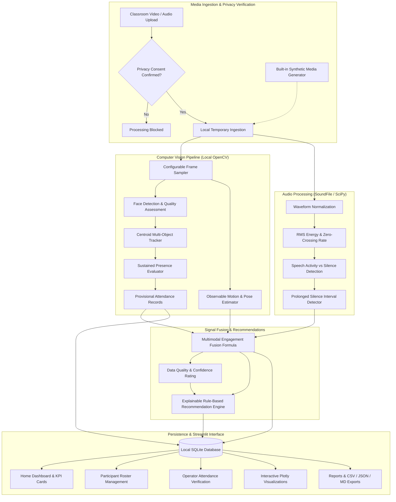

# Multimodal Attendance & Engagement Agent
### AI-Powered, Privacy-Conscious Classroom Intelligence Platform

[](https://www.python.org/)
[](https://streamlit.io/)
[](https://opencv.org/)
[](https://plotly.com/)
[](https://pytest.org/)
[](LICENSE)

An intelligent, local-first educational assistance system that automates attendance tracking from classroom video, analyzes observable multimodal activity indicators (motion, presence, acoustic energy, silence), and generates explainable, non-punitive pedagogical recommendations. Built specifically for evaluation on the **FutureSkills Prime** platform.

---

## 📌 Project Links & Video Demonstration

- **GitHub Repository:** `https://github.com/<your-username>/multimodal-attendance-engagement-agent` *(Replace with your URL)*
- **Walkthrough Demonstration Video:** `https://youtu.be/<your-demo-video-id>` *(3–5 minute recorded screencast following `DEMO_SCRIPT.md`)*

---

## 🌟 Key Features

1. **Automated Attendance from Video:**
   - Configurable frame sampling interval (0.5s – 5.0s) for efficient processing on standard 8GB RAM laptops.
   - OpenCV Haar Cascade face detection with image quality diagnostics (lighting, contrast, blur).
   - Centroid tracking with Euclidean distance matching across frames.
   - **Sustained-Presence Rules:** Eliminates transient, 1-frame false positives; tracks must exceed minimum duration (default 30% of session) to qualify as Present.
   - **Privacy-First Identity Model:** Face detection assigns anonymous track IDs (`Track-001`). Provisional attendance requires authorized operator review before confirming identity mappings. Never invents identities.

2. **Multimodal Engagement Proxy Analytics:**
   - Observational signal fusion combining Visual Presence, Observable Motion (pixel-differencing variance), Audio Energy (RMS), and Frontal Pose Proxies.
   - Dynamic weight re-normalization when modalities are absent (graceful fallback for video-only or audio-only sessions).
   - Detection of continuous speech, speaking-to-silence ratios, and prolonged quiet intervals.
   - Data Quality / Confidence Metric assessing lighting conditions, motion blur, and acoustic clipping.

3. **Explainable AI Pedagogical Recommendation Engine:**
   - 100% local, rule-based recommendation system based on computed metrics.
   - Every recommendation provides:
     - The triggering observation.
     - Timestamped supporting metrics and duration intervals.
     - Practical, constructive teaching suggestions (e.g. think-pair-share, concept checkpoints).
     - Essential pedagogical caveats (e.g., reminding instructors that silence often indicates intense contemplation or exam solving).

4. **Interactive Visualizations & Reporting:**
   - Interactive Plotly visualizations: Multimodal dynamics timeline with shaded silence intervals, attendance status donut chart, observation duration per track, and multi-session comparison.
   - Downloadable attendance records in **CSV format**.
   - Comprehensive session summaries in **JSON format**.
   - Formatted executive session summaries in **Markdown**.

5. **Local Privacy by Design:**
   - Zero external cloud AI API dependencies; runs completely offline.
   - Raw facial photos or biometric vector templates are **never stored**.
   - Built-in disk management: one-click temporary media cleanup and session data purging.

6. **Deterministic Sample Data & Demo Mode:**
   - Immediate evaluation without hardware cameras or private recordings.
   - Pre-seeded 10-minute simulated session and 8 sample students.
   - Built-in programmatic synthetic video and audio generator.

---

## 🏗️ System Architecture & Workflow



---

## 💻 Technology Stack

| Component | Technology | Rationale |
| :--- | :--- | :--- |
| **Frontend UI** | Streamlit 1.35+ | Python-native interactive web dashboard with custom CSS theme. |
| **Visualizations** | Plotly 5.20+ | Responsive, interactive charts with zooming, panning, and tooltips. |
| **Computer Vision** | OpenCV 4.14+ | Lightweight, local frame extraction, Haar Cascade face detection, and motion tracking. |
| **Audio Processing** | SoundFile, SciPy, Wave | Offline acoustic energy calculation, speech candidate detection, and silence intervals. |
| **Data Processing** | NumPy, Pandas, Scikit-Learn | Vectorized signal calculations and data frame manipulation. |
| **Storage & Persistence**| SQLite 3 | Serverless, zero-configuration local ACID database. |
| **Automated Testing**| pytest 8.0+ | Comprehensive automated test suite for rules, math, and database CRUD. |

---

## 📂 Project Directory Structure

```
multimodal-attendance-agent/
├── app.py                          # Main entry point & Home Dashboard
├── config.py                       # Global constants, paths, and thresholds
├── requirements.txt                # Python project dependencies
├── README.md                       # Comprehensive documentation
├── DEMO_SCRIPT.md                  # 3-5 minute video presentation plan
├── .gitignore                      # Git exclusion rules
├── .streamlit/
│   └── config.toml                 # Streamlit theme & headless settings
├── modules/
│   ├── __init__.py                 # Module initializer
│   ├── video_processor.py          # Frame extraction, motion, and video pipeline
│   ├── face_detector.py            # Local face detection & quality metrics
│   ├── tracking.py                 # Centroid multi-object tracker
│   ├── attendance.py               # Sustained presence rules & attendance status
│   ├── audio_processor.py          # Acoustic RMS energy, speech & silence detection
│   ├── engagement.py               # Multimodal signal fusion & quality index
│   ├── recommendation_engine.py    # Explainable pedagogical rule engine
│   ├── analytics.py                # Plotly visualization generators
│   ├── database.py                 # SQLite schema & CRUD operations
│   ├── report_generator.py         # CSV, JSON, and Markdown export builders
│   ├── privacy.py                  # Storage cleanup & privacy audit routines
│   ├── demo_data.py                # Deterministic simulation & synthetic media generator
│   └── ui_common.py                # Shared CSS and UI components
├── pages/
│   ├── 1_📊_Dashboard.py           # Multimodal charts & session comparison
│   ├── 2_👥_Participants.py        # Student roster & CSV batch import
│   ├── 3_🎯_Session_Analysis.py    # Session setup, live analysis & attendance mapping
│   ├── 4_📑_Reports.py             # AI suggestions, report preview & downloads
│   └── 5_⚙️_Settings.py            # Privacy audits, cleanup, and runtime diagnostics
├── tests/
│   ├── test_attendance.py          # Sustained-presence & noise filtering tests
│   ├── test_engagement.py          # Signal fusion, bounds & missing signal tests
│   ├── test_recommendations.py     # Rule triggers & pedagogical evidence tests
│   └── test_database.py            # SQLite CRUD, demo tagging & export tests
├── data/
│   ├── .gitkeep
│   ├── classroom_intelligence.db   # Local SQLite database (created on first run)
│   ├── exports/                    # Generated report exports
│   └── temp_uploads/               # Temporary media upload folder
└── sample_data/
    ├── README.md                   # Sample data & simulation instructions
    ├── sample_classroom_10s.mp4    # Generated synthetic test video
    └── sample_classroom_10s.wav    # Generated synthetic test audio
```

---

## ⚙️ Installation & Setup Instructions

### 1. Prerequisites
- **Python 3.10, 3.11, 3.12, or 3.13** installed on your machine.
- At least **8 GB RAM** and standard CPU (no dedicated GPU required).

### 2. Clone Repository or Extract Project
```bash
git clone https://github.com/<your-username>/multimodal-attendance-engagement-agent.git
cd multimodal-attendance-engagement-agent
```

### 3. Create and Activate Virtual Environment
**Windows (PowerShell):**
```powershell
python -m venv venv
.\venv\Scripts\Activate.ps1
```

**macOS / Linux:**
```bash
python3 -m venv venv
source venv/bin/activate
```

### 4. Install Dependencies
```bash
pip install --upgrade pip
pip install -r requirements.txt
```

---

## 🚀 Running the Application

Launch the Streamlit web interface:
```bash
streamlit run app.py
```

The browser will automatically open at:
```
http://localhost:8501
```

---

## 🧪 Running Automated Tests

To execute the complete test suite (17 comprehensive unit tests verifying sustained-presence math, signal fusion bounds, rule triggers, and database persistence):

```bash
python -m pytest tests/ -v
```

Expected output:
```
============================= test session starts =============================
tests/test_attendance.py::test_sustained_presence_present PASSED         [  5%]
tests/test_attendance.py::test_intermittent_partial_attendance PASSED    [ 11%]
tests/test_attendance.py::test_noise_filtering PASSED                    [ 17%]
tests/test_attendance.py::test_attendance_summary_calculations PASSED    [ 23%]
tests/test_database.py::test_participant_crud PASSED                     [ 29%]
tests/test_database.py::test_session_and_attendance_flow PASSED          [ 35%]
tests/test_database.py::test_demo_mode_tagging_and_seeding PASSED        [ 41%]
tests/test_database.py::test_report_exports PASSED                       [ 47%]
tests/test_engagement.py::test_motion_normalization_bounds PASSED        [ 52%]
tests/test_engagement.py::test_signal_fusion_multimodal PASSED           [ 58%]
tests/test_engagement.py::test_signal_fusion_audio_missing PASSED        [ 64%]
tests/test_engagement.py::test_signal_fusion_video_missing PASSED        [ 70%]
tests/test_engagement.py::test_data_quality_index PASSED                 [ 76%]
tests/test_recommendations.py::test_silence_trigger PASSED               [ 82%]
tests/test_recommendations.py::test_engagement_drop_trigger PASSED       [ 88%]
tests/test_recommendations.py::test_monologue_trigger PASSED             [ 94%]
tests/test_recommendations.py::test_quality_issues_trigger PASSED        [100%]
============================= 17 passed in 2.08s ==============================
```

---

## 💡 How to Test Without Real Video (Demo Mode)

Evaluators do not need to upload real recordings:

1. **Deterministic Demo Mode (Instant Simulation):**
   - On the Home Dashboard, click **"🚀 Load Deterministic Demo Session"**.
   - Navigate to **"1 📊 Dashboard"** or **"4 📑 Reports"** to view realistic timelines, attendance breakdowns, and AI recommendations.
   - All demo data is explicitly tagged with `[Simulated Demo]` badges.

2. **Programmatic Synthetic Media Pipeline (Actual Pipeline Execution):**
   - Navigate to **"3 🎯 Session Analysis"**.
   - Check **"🧪 Use Built-in 10-Second Test Media Sample"**.
   - Check the privacy consent box and click **"Start Multimodal Analysis"**.
   - The application programmatically generates a test video (`sample_classroom_10s.mp4`) and audio (`sample_classroom_10s.wav`) and runs the actual OpenCV frame extractor, face detector, centroid tracker, and acoustic signal processor!

---

## ⚖️ Limitations & Ethical Considerations

1. **Observational Proxies vs. Mental States:**
   - Visual movement, head orientation, and acoustic energy are **observational proxies**. They do **NOT** measure cognitive comprehension, attentiveness, emotional sentiment, or student learning.
   - A student looking down may be writing detailed notes or reading problem sets; silence may indicate deep concentration. The application explicitly labels these limitations on every page.

2. **Non-Consequential Assessment:**
   - Recommendations are advisory prompts to assist the instructor with lesson pacing and activity variety. They must **never** be used to penalize, grade, or evaluate students.

3. **Consent and Operator Verification:**
   - The computer vision detector assigns anonymous track IDs (`Track-001`). Provisional attendance requires human instructor review and confirmation. Automatic biometric identification is strictly avoided.

---

## 📸 Application Screenshots

*(Capture screens using your browser and place image files in a `screenshots/` directory)*

| Section | Description |
| :--- | :--- |
| **Home Dashboard** | Overview KPI cards, local execution status, and quick demo seeding. |
| **Session Analysis** | Video/audio ingestion, progress bar, and provisional attendance table. |
| **Analytics Dashboard** | Interactive Plotly multimodal timeline, donut chart, and track duration bars. |
| **Pedagogical Reports** | Prioritized AI recommendations with trigger metrics, suggestions, and caveats. |
| **Privacy & Settings** | Zero cloud audit, temporary storage cleanup, and factory reset controls. |

---

## 📄 License
This project is licensed under the MIT License - see the LICENSE file for details. Built as an academic submission for the **FutureSkills Prime** platform.
